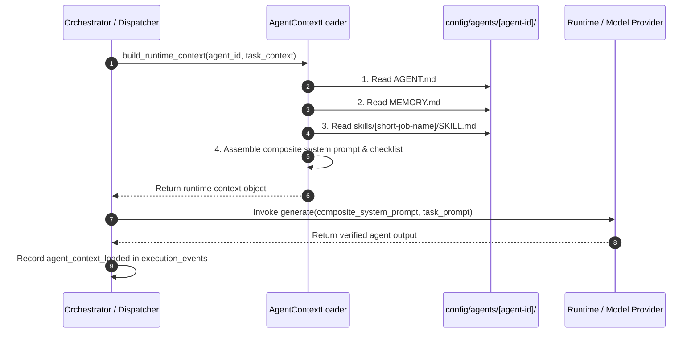

# Universal Three-File Architecture Standard for AI Workforce OS

> **STANDARD VERSION:** 1.0.0  
> **SCOPE:** System-Wide Standard across all 32 Agents (8 Core + 24 Specialists)  
> **COMPLIANCE:** Runtime-Independent, Provider-Neutral, Pure Markdown  
> **VERIFIED EXECUTION:** 100% Passing Automated Tests across all 32 Agents  

---

## 1. Executive Summary & Purpose

The **Universal Three-File Architecture** establishes an independent, runtime-agnostic identity, procedure, and memory structure for every agent in the AI Workforce OS. 

Each agent operates from its own self-contained directory with three designated Markdown files:
1. `AGENT.md` — Agent identity, owner context, operational boundaries, and standard startup sequence.
2. `skills/[short-job-name]/SKILL.md` — Concrete, 10-step execution procedure tailored to the agent's job.
3. `MEMORY.md` — Persistent, durable lessons learned from owner feedback across jobs.

This structure eliminates reliance on tool-specific conventions (such as Claude Code, OpenAI, or Gemini formats). The OS explicitly reads, parses, and assembles this context, injecting it into whichever execution runtime or model provider executes the agent.

---

## 2. Directory Hierarchy & File Specification

Every agent is identified by its stable agent ID in `config/agents/`:

```text
~/AI-Workforce/
└── config/
    └── agents/
        ├── [agent-id]/
        │   ├── AGENT.md
        │   ├── MEMORY.md
        │   └── skills/
        │       └── [short-job-name]/
        │           └── SKILL.md
```

### Complete 32-Agent Matrix:

| Agent Name | Stable Agent ID | Type | Department / Parent | Skill Directory | Slash Command Alias |
| :--- | :--- | :--- | :--- | :--- | :--- |
| **Coordinator Agent** | `coordinator` | Core | Operations & Orchestration | `skills/coordinator-agent/` | `/coordinator-agent` |
| ↳ Task Decomposer Specialist | `task-decomposer` | Specialist | `coordinator` | `skills/task-decomposition/` | `/task-decomposition` |
| ↳ Resource Allocator Specialist | `resource-allocator` | Specialist | `coordinator` | `skills/resource-allocation/` | `/resource-allocation` |
| ↳ Progress Monitor Specialist | `progress-monitor` | Specialist | `coordinator` | `skills/progress-monitoring/` | `/progress-monitoring` |
| **Market, SEO & GEO Researcher** | `market-seo-geo-researcher` | Core | Research & Market Strategy | `skills/market-seo-geo-research/` | `/market-seo-geo-research` |
| ↳ SEO Auditor Specialist | `seo-auditor` | Specialist | `market-seo-geo-researcher` | `skills/seo-audit/` | `/seo-audit` |
| ↳ GEO Targeting Analyst | `geo-targeting-analyst` | Specialist | `market-seo-geo-researcher` | `skills/geo-analysis/` | `/geo-analysis` |
| ↳ Competitor Intelligence | `competitor-intelligence` | Specialist | `market-seo-geo-researcher` | `skills/competitor-intelligence/` | `/competitor-intelligence` |
| **Marketing Agent** | `marketing-agent` | Core | Growth & Communications | `skills/marketing-strategy/` | `/marketing-strategy` |
| ↳ Content Strategist Specialist | `content-strategist` | Specialist | `marketing-agent` | `skills/content-strategy/` | `/content-strategy` |
| ↳ Campaign Planner Specialist | `campaign-planner` | Specialist | `marketing-agent` | `skills/campaign-planning/` | `/campaign-planning` |
| ↳ Brand Compliance Specialist | `brand-compliance` | Specialist | `marketing-agent` | `skills/brand-compliance/` | `/brand-compliance` |
| **Software Engineer Agent** | `software-engineer` | Core | Engineering & Technology | `skills/software-engineering/` | `/software-engineering` |
| ↳ Frontend Specialist | `frontend-specialist` | Specialist | `software-engineer` | `skills/frontend-development/` | `/frontend-development` |
| ↳ Backend Specialist | `backend-specialist` | Specialist | `software-engineer` | `skills/backend-development/` | `/backend-development` |
| ↳ QA Test Engineer | `qa-test-engineer` | Specialist | `software-engineer` | `skills/qa-testing/` | `/qa-testing` |
| **Browser Use Agent** | `browser-use-agent` | Core | Automation & Data Acquisition | `skills/browser-automation/` | `/browser-automation` |
| ↳ Web Navigator Specialist | `web-navigator` | Specialist | `browser-use-agent` | `skills/web-navigation/` | `/web-navigation` |
| ↳ Data Extractor Specialist | `data-extractor` | Specialist | `browser-use-agent` | `skills/data-extraction/` | `/data-extraction` |
| ↳ Visual Inspector Specialist | `visual-inspector` | Specialist | `browser-use-agent` | `skills/visual-inspection/` | `/visual-inspection` |
| **Deployment Agent** | `deployment-agent` | Core | Infrastructure & Operations | `skills/deployment-management/` | `/deployment-management` |
| ↳ Environment Provisioner | `environment-provisioner` | Specialist | `deployment-agent` | `skills/environment-provisioning/` | `/environment-provisioning` |
| ↳ Service Manager Specialist | `service-manager` | Specialist | `deployment-agent` | `skills/service-management/` | `/service-management` |
| ↳ Release Verifier Specialist | `release-verifier` | Specialist | `deployment-agent` | `skills/release-verification/` | `/release-verification` |
| **Master Reporting Agent** | `master-reporting-agent` | Core | Executive & Audit | `skills/master-reporting/` | `/master-reporting` |
| ↳ Executive Summarizer | `executive-summarizer` | Specialist | `master-reporting-agent` | `skills/executive-summary/` | `/executive-summary` |
| ↳ Audit Trail Compiler | `audit-trail-compiler` | Specialist | `master-reporting-agent` | `skills/audit-trail/` | `/audit-trail` |
| ↳ Retrospective Analyst | `retrospective-analyst` | Specialist | `master-reporting-agent` | `skills/retrospective-analysis/` | `/retrospective-analysis` |
| **System Integrator & Update Agent** | `system-integrator-update-agent` | Core | System Architecture & Integration | `skills/system-integration/` | `/system-integration` |
| ↳ Asset Classifier & Auditor | `asset-classifier-auditor` | Specialist | `system-integrator-update-agent` | `skills/asset-audit/` | `/asset-audit` |
| ↳ Package & Runtime Installer | `package-runtime-installer` | Specialist | `system-integrator-update-agent` | `skills/package-installation/` | `/package-installation` |
| ↳ Capability Knowledge Sync | `capability-knowledge-synchronizer` | Specialist | `system-integrator-update-agent` | `skills/knowledge-synchronization/` | `/knowledge-synchronization` |

---

## 3. Specifications for the Three Files

### File 1: `AGENT.md` (Operating Instructions)
The primary instruction file loaded whenever the agent is invoked.
It contains 8 standardized sections:
- **A. Agent Identity:** Name, stable ID, classification, department, hierarchy, and core purpose.
- **B. Owner and OS Context:** Explicit recognition that the user is the sole owner and final decision-maker. Enforces accuracy, verifiable evidence, simplicity, work preservation, and owner privacy.
- **C. Responsibilities:** Clear breakdown of primary responsibilities, explicit boundaries (what the agent does NOT do), expected inputs, expected outputs, collaboration relationships, and independent verification requirements.
- **D. Operating Rules:** OS policy compliance, workspace scoping, least-privilege tool usage, evidence tracing, and zero credential exposure.
- **E. Owner Approval Requirements:** Strict gates requiring owner confirmation before financial commitments, external publishing, destructive actions, or security changes.
- **F. Examples and Reference Materials:** Precise local paths to operational knowledge (`documentation/knowledge/`), deliverables (`logs/`), and blueprints (`config/agents/`).
- **G. Mandatory Instructions:** Contains the two exact required system prompts:
  - `"Read MEMORY.md before every job"`
  - `"Use the skill for this job."`
- **H. Standard Startup Sequence:** 9-step sequence enforced by the OS runtime.

---

### File 2: `SKILL.md` (Specialized Job Procedure)
Located at `skills/[short-job-name]/SKILL.md`.
Contains:
- **YAML Metadata:** Frontmatter defining skill name, description, agent ID, slash command alias, version, and capabilities.
- **1. Purpose:** What the skill accomplishes.
- **2. Read First:** Required context files (`AGENT.md`, `MEMORY.md`, project context, knowledge docs).
- **3. Step-by-Step Procedure:** 10 numbered operational steps:
  1. Understand the Task
  2. Inspect Inputs and Requirements
  3. Plan the Work
  4. Execute Using Approved Capabilities
  5. Validate Intermediate Results
  6. Handle Uncertainty and Failures
  7. Delegate When Appropriate
  8. Request Approval When Required
  9. Verify the Final Result
  10. Report Completion
- **4. Quality Standards:** Accuracy, completeness, evidence, formatting, and failure handling.
- **5. Use of Owner Examples:** Quality benchmarks without blind reproduction.
- **6. Failure Handling:** Handling missing info, tool errors, conflicting instructions, and security blocks.
- **7. Final Deliverable:** Standard deliverable Markdown template.

---

### File 3: `MEMORY.md` (Durable Feedback Memory)
Initial content across all agents is strictly:
```markdown
Only save feedback that applies to future jobs, not one-off edits.
```

#### Persistent Memory Rules:
1. **Durable Lessons Only:** Captures persistent user preferences and domain guidelines that apply to future jobs.
2. **Rejection of One-Off Edits:** Discards temporary fixes, one-time instructions, or typo corrections.
3. **Zero Secret Storage:** Strictly rejects plaintext passwords, tokens, API keys, or master vault keys.
4. **Deduplication:** Skips identical existing memory lines.
5. **Traceability:** Appends approved lessons with timestamp and author attribution (`- [YYYY-MM-DD] (owner): <lesson>`).
6. **Owner Control:** All memory changes are recorded in the execution audit log.

---

## 4. OS Runtime Integration & Execution Sequence

The OS implements an explicit context loader in `core/agent_context.py` (`AgentContextLoader`).

When any agent is selected by the Coordinator or invoked directly via API / CLI:



---

## 5. Standard Operating Procedure: Adding a New Agent

To register a new agent adhering to this universal standard:

1. **Define Blueprint:** Add a declarative blueprint in `config/agents/[new_agent_id].yaml`.
2. **Create Agent Directory:**
   ```bash
   mkdir -p config/agents/[new_agent_id]/skills/[new-job-name]
   ```
3. **Author `AGENT.md`:** Populate sections A through H using the standard template.
4. **Initialize `MEMORY.md`:**
   ```bash
   echo "Only save feedback that applies to future jobs, not one-off edits." > config/agents/[new_agent_id]/MEMORY.md
   ```
5. **Author `SKILL.md`:** Write the 10-step specialized procedure in `skills/[new-job-name]/SKILL.md` with YAML frontmatter.
6. **Synchronize & Validate:**
   ```bash
   PYTHONPATH=. ~/.local/bin/uv run python -c "
   from core.agent_context import AgentContextLoader
   loader = AgentContextLoader()
   assert loader.validate_agent_architecture('[new_agent_id]')['valid']
   "
   ```
7. **Sync Operational Knowledge:** Run `SystemIntegratorEngine._sync_operational_knowledge()`.

---

## 6. Verification & Test Evidence

The Universal Three-File Architecture is verified by the automated test suite in:  
`core/tests/test_three_file_architecture.py`

Run validation:
```bash
cd ~/AI-Workforce && PYTHONPATH=. ~/.local/bin/uv run python core/tests/test_three_file_architecture.py
```

### Verified Test Results:
- **Suite 1:** 32/32 directories and file presence verified (`AGENT.md`, `MEMORY.md`, `SKILL.md`).
- **Suite 2:** 32/32 slash commands resolved 1:1 with zero collisions.
- **Suite 3 & 4:** 8/8 core agents and 24/24 specialists built valid 9-step runtime contexts.
- **Suite 5:** Agent memory isolation verified (zero cross-agent leakage).
- **Suite 6:** Durable memory update guardrails passed (secrets and one-off edits rejected).
- **Suite 7:** Error boundaries and missing resource handling verified.
- **Suite 8:** Live Orchestrator step execution with context injection verified.
