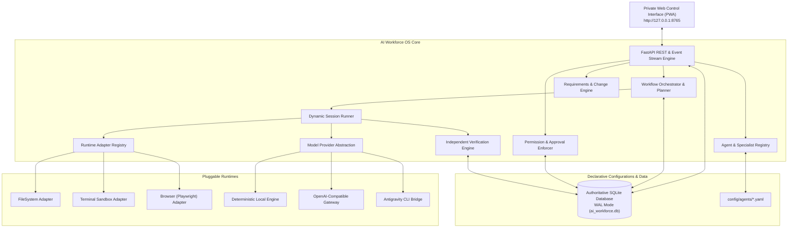

# AI Workforce OS: Architecture & System Design Document

**System Name:** Personal AI Operating System (AI Workforce OS)  
**Root Workspace:** `~/AI-Workforce/`  
**Current Host:** MacBook Pro 15-inch 2018 (Intel Core i7-8850H, 16 GB RAM, macOS Sequoia 15.8.3)  
**Target Environment:** Local macOS Workstation & Future VPS Cloud Node  
**Status:** MVP Implementation Phase  

---

## 1. System Vision & Principles

The AI Workforce OS is a private, lightweight, extensible operating system designed to orchestrate autonomous AI agents, specialists, workflows, and tools into a cohesive workforce.

### Architectural Principles
1. **Modularity over Monoliths:** Core runtime, agent blueprints, runtime adapters, and model providers are decoupled via clean interfaces.
2. **Declarative Blueprints, Ephemeral Sessions:** Agent organizations and subagents are defined declaratively in versioned configurations. When tasks run, dynamic execution sessions are instantiated and terminated—no wasteful permanent background agent daemons.
3. **Relational Durability:** A single authoritative relational SQLite database with Write-Ahead Logging (WAL) ensures ACID transactions, fast concurrent reads, auditability, and zero daemon overhead.
4. **Hardware-Conscious:** Engineered to run smoothly on a 16 GB Intel Mac alongside IDEs and development tools, with a total idle footprint under 60 MB RAM.
5. **Private & Secure by Default:** Binds exclusively to localhost (`127.0.0.1`), enforces strict permission gates, requires human approval for sensitive actions, and never leaks credentials in code or logs.
6. **Continuous Extensibility:** Features a formal Requirements & Change Management engine that evaluates proposed modifications against the running architecture, drafts change plans, and applies updates without complete rebuilds.

---

## 2. Component Architecture

---

## 3. The 7 Configurable Agent Organizations & Specialists

The initial operating structure contains 7 core departments with specialized subagents. These are defined declaratively in `config/agents/` and synchronized to the database:

1. **Coordinator Agent (`coordinator`)**
   - *Department:* Operations & Orchestration
   - *Role:* High-level task intake, dependency graph decomposition, agent delegation, and milestone synthesis.
   - *Specialists:*
     - `task-decomposer`: Breaks complex goals into sequential and parallel DAG steps.
     - `resource-allocator`: Selects optimal agent blueprints and tools.
     - `progress-monitor`: Tracks step status, bottlenecks, and routes approval requests.

2. **Market, SEO & GEO Researcher Agent (`market-seo-geo-researcher`)**
   - *Department:* Research & Market Strategy
   - *Role:* Market trend analysis, keyword research, localized search rankings, and competitor intelligence.
   - *Specialists:*
     - `seo-auditor`: Technical SEO, keyword clusters, metadata, search intent analysis.
     - `geo-targeting-analyst`: Region-specific ranking signals, localization, geographical market dynamics.
     - `competitor-intelligence`: Competitive feature benchmarks, pricing models, positioning analysis.

3. **Marketing Agent (`marketing-agent`)**
   - *Department:* Growth & Communications
   - *Role:* Campaign creation, copywriting, conversion optimization, and brand narrative.
   - *Specialists:*
     - `content-strategist`: Blog outlines, social copy, editorial schedules, audience resonance.
     - `campaign-planner`: Multi-channel campaign structures, funnel optimization.
     - `brand-compliance`: Verification of brand voice guidelines, messaging safety.

4. **Software Engineer Agent (`software-engineer`)**
   - *Department:* Engineering & Technology
   - *Role:* Architecture design, full-stack code implementation, bug fixing, and test automation.
   - *Specialists:*
     - `frontend-specialist`: Responsive UI/UX, DOM state, accessibility, modern web components.
     - `backend-specialist`: REST APIs, data models, schema migrations, security logic.
     - `qa-test-engineer`: Unit tests, integration assertions, fixture setup, regression validation.

5. **Browser Use Agent (`browser-use-agent`)**
   - *Department:* Automation & Data Acquisition
   - *Role:* Web navigation, authenticated interactions, web data scraping, and visual testing.
   - *Specialists:*
     - `web-navigator`: Headless Chromium control via Playwright, form entry, link traversal.
     - `data-extractor`: Table extraction, structured JSON parsing, text content extraction.
     - `visual-inspector`: Screenshot capture, visual element verification, page layout inspection.

6. **Deployment Agent (`deployment-agent`)**
   - *Department:* Infrastructure & Operations
   - *Role:* Local and remote service lifecycle, environment provisioning, and health verification.
   - *Specialists:*
     - `environment-provisioner`: Tool and runtime checks, directory initialization, environment variables.
     - `service-manager`: Process supervision, daemon lifecycle, port conflict resolution.
     - `release-verifier`: Smoke tests, post-deploy HTTP status checks, automated rollback gates.

7. **Master Reporting Agent (`master-reporting-agent`)**
   - *Department:* Executive & Audit
   - *Role:* Aggregating task histories, compiling comprehensive audit logs, and preparing executive deliverables.
   - *Specialists:*
     - `executive-summarizer`: High-level executive briefs, key metric dashboards, milestone summaries.
     - `audit-trail-compiler`: Detailed chronological log verification, security audits.
     - `retrospective-analyst`: Process bottlenecks analysis, velocity tracking, agent improvement recommendations.

---

## 4. Data & Task Lifecycle Model

The authoritative SQLite database schema manages the full execution lifecycle:

- `tasks`: Top-level user objective with priority, status (`pending` -> `planning` -> `in_progress` -> `awaiting_approval` -> `verifying` -> `completed` / `failed`), input context, and final result.
- `task_plans`: Execution plan formulated by the Coordinator, containing discrete actionable steps with assigned agents, prerequisites, and expected outputs.
- `execution_events`: Immutable audit trail of every system action (plan formulated, tool invoked, output received, approval requested).
- `approvals`: Human-in-the-loop gates required before executing sensitive operations (external network calls, purchases, destructive file changes, credentials).
- `verifications`: Independent verification records evaluating task outputs against defined constraints and quality standards.
- `system_requirements`: Changelog and proposed requirements, tracking changes to blueprints, providers, or workflows.

---

## 5. Technology Stack

- **Backend & Orchestration:** Python 3.12 (managed via `uv`), FastAPI, Pydantic v2, Uvicorn, PyYAML, aiosqlite.
- **Authoritative Database:** SQLite 3 (WAL mode enabled, foreign keys enforced).
- **Automation Engine:** Playwright Python with Chromium Headless Shell (tested & verified).
- **Interface:** Lightweight Private Web / PWA Control Panel (pure HTML5, CSS3, modern Vanilla JS, responsive dark theme, zero external CDN dependencies).
- **Process Management:** Single lightweight command `start_os.sh` and `stop_os.sh` with PID tracking.
