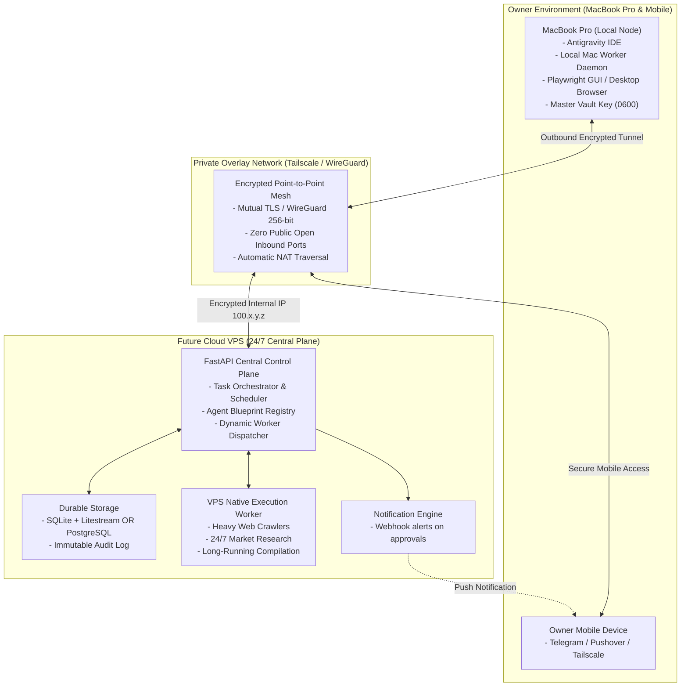
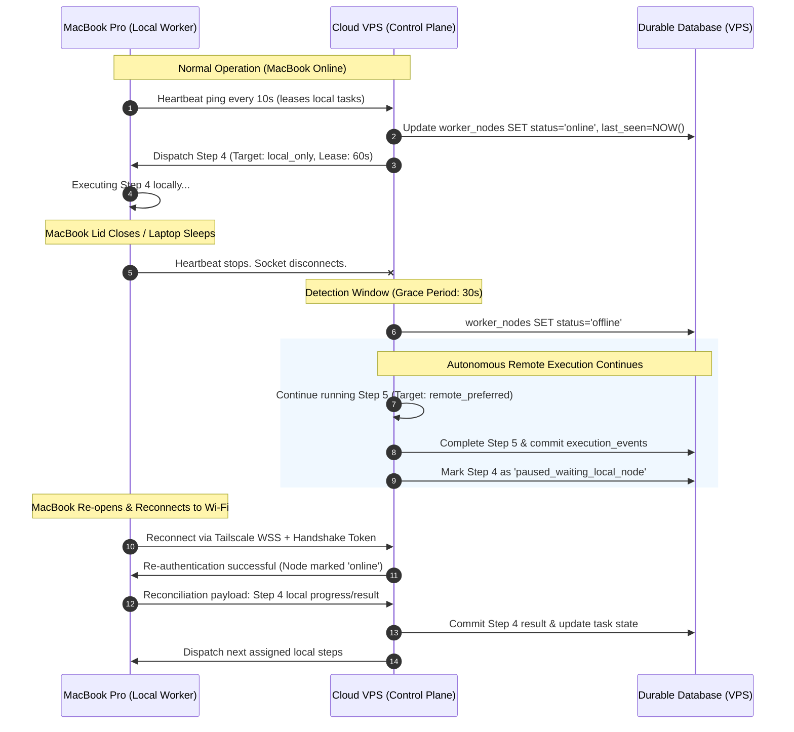
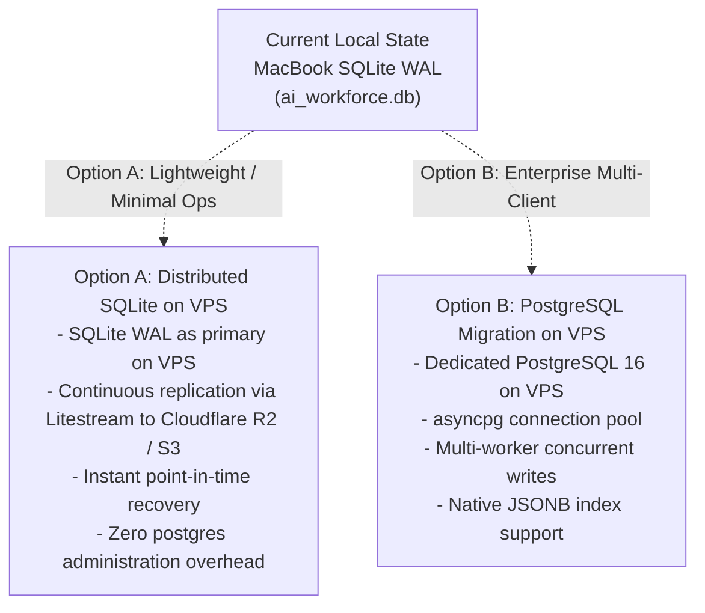
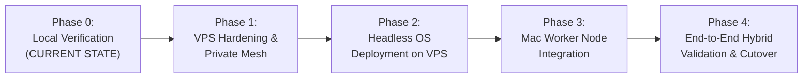

# AI Workforce OS — Future VPS & Hybrid Architecture Deployment Plan

> **STATUS:** ARCHITECTURAL DESIGN & MIGRATION BLUEPRINT  
> **CURRENT EXECUTION TOPOLOGY:** 100% LOCAL (MacBook Pro 15-inch 2018, Intel Core i7, 16 GB RAM, macOS Sequoia 15.8.3)  
> **REMOTE INFRASTRUCTURE STATUS:** NO ACTIVE VPS / NO REMOTE CLOUD DEPENDENCIES  
> **AUTHORITATIVE STORAGE:** Local SQLite WAL (`~/AI-Workforce/data/ai_workforce.db`)  
> **AUTHORITATIVE SECRETS:** Local Fernet Master Vault (`~/.ai_workforce_vault.key`, mode `0600`)  

---

## 1. Executive Clarification & Guiding Constraints

This document defines the architectural strategy, separation of concerns, communication protocols, and phased implementation path for migrating the **AI Workforce OS** from a single-machine local workstation deployment to a **Hybrid Mac-VPS topology** in a future phase.

### Immediate Invariants (Present Phase)
1. **Zero Cloud Dependencies:** The AI Workforce OS runs entirely on the host MacBook Pro. No external VPS, cloud queue, remote database, or managed third-party services (such as Vercel, Supabase, AWS, or GCP) are provisioned or assumed to exist.
2. **Preservation of Local Integrity:** The operational SQLite database (`ai_workforce.db`) operating in Write-Ahead Logging (`WAL`) mode, the local Fernet encrypted credential vault, Playwright browser automation engines, Antigravity IDE bindings, and local filesystem adapters remain strictly local.
3. **No Premature Containerization:** Docker containers, multi-tenant Kubernetes manifests, or distributed message brokers (such as RabbitMQ or Redis) must NOT be introduced into the local development environment today.
4. **Zero Refactoring Rule:** The future hybrid architecture is designed so that when a VPS is acquired, the core OS business logic, database models, agent blueprints, and task lifecycle state machines require **zero structural rewrites**. The transition occurs through modular adapter injection and network routing boundaries.

---

## 2. Separation of Responsibilities: Local vs. Hybrid Matrix

To guarantee clean future distribution across machines, the system responsibilities are decoupled into nine distinct functional layers. 

| System Component | Current Local Mode (MacBook Pro) | Future Hybrid Mode (MacBook Pro + VPS) | Inter-Node Boundary / Protocol |
| :--- | :--- | :--- | :--- |
| **1. Control Plane & API** | FastAPI running on `127.0.0.1:8765` locally. | Headless FastAPI running on VPS (24/7 daemon). | HTTPS / WSS over private Tailscale mesh network. |
| **2. Durable Task Storage** | Local SQLite WAL (`ai_workforce.db`). | Central Primary Database on VPS (SQLite + Litestream or PostgreSQL). | Async DB Driver (`aiosqlite` / `asyncpg`) with connection pooling. |
| **3. Task Coordination & Scheduling** | Local in-process `Orchestrator` & event loop. | Central Scheduler on VPS delegating tasks to registered worker nodes. | Dynamic Node Router evaluating task tags (`runtime_target`). |
| **4. Local Mac Execution Adapters** | Direct local subprocess, Playwright Chromium, Mac filesystem. | Remote-controlled **Local Mac Worker Daemon** executing local tasks. | Outbound WebSocket / gRPC stream from Mac to VPS Control Plane. |
| **5. Remote Execution Adapters** | Not present (emulated/mocked locally). | VPS Native Worker executing headless background scraping, builds, and indexing. | Direct local process execution on the VPS server. |
| **6. Credentials & Secrets** | Local AES-128-CBC Fernet Vault (`~/.ai_workforce_vault.key`). | Split-Zero-Trust: Local keys stay on Mac; VPS receives short-lived session tokens (`sess_...`). | Ephemeral JWT / Session Broker API with user approval gates. |
| **7. Project Files & Artifacts** | Local directory (`~/AI-Workforce/logs/`, `config/`). | Distributed: VPS stores shared deliverables; Git/rsync synchronizes code. | Git remote repository + S3/MinIO/rsync for binary deliverables. |
| **8. Logging & Auditing** | SQLite `execution_events` and `security_audit_log`. | Centralized append-only audit log on VPS + local ring buffer on Mac. | Batched event push over TLS with local offline spillover queue. |
| **9. Owner Notifications** | Local browser notifications & OS alerts. | Centralized Dispatcher (Telegram Bot, Discord Webhook, Pushover, Email). | Outbound HTTPS Webhooks from VPS to owner mobile/desktop devices. |

---

## 3. Communication & Networking Architecture

When the VPS is introduced, exposing the AI Workforce OS directly to the public internet via open ports (e.g., exposing port `8765` or SSH port `22`) introduces unnecessary attack surfaces. The hybrid deployment mandates a **Zero-Trust Private Mesh Network**.



### Key Networking Principles
1. **No Inbound Public Ports on Mac:** The MacBook Pro is frequently behind dynamic domestic ISP routers, NATs, and Wi-Fi firewalls. The Mac node **never listens on a public IP**. Instead, the Mac Worker initiates an **outbound persistent TLS WebSocket connection** (`wss://vps.internal.net/ws/workers/mac`) to the VPS over the private mesh.
2. **Tailscale / WireGuard Overlay:** Both the MacBook and the VPS join an isolated Tailscale Tailnet. Traffic is restricted exclusively to authenticated nodes via Tailscale Access Control Lists (ACLs). The VPS binds its web interface strictly to its Tailscale IP (`100.x.y.z`), completely inaccessible to the wider internet.
3. **mTLS & Ephemeral Worker Tokens:** When the Mac Worker connects to the VPS, it authenticates using a cryptographically signed node certificate or high-entropy worker token (`WORKER_MAC_NODE_SECRET`) with mutual TLS (mTLS), preventing rogue worker registration.

---

## 4. Execution Distribution & Dynamic Task Routing

The task orchestration engine will dynamically route plan steps based on capability requirements and machine affinities.

### Task Target Taxonomy
Every task or plan step carries an execution target attribute:
- `runtime_target: "local_only"`: Tasks requiring local desktop resources, macOS keychain/files, Chrome desktop user profiles, or Antigravity IDE interaction (e.g., local code testing, visual UI inspection, local file editing).
- `runtime_target: "remote_preferred"`: Resource-intensive, long-running, or 24/7 tasks that should run continuously in the background (e.g., continuous market trend scraping, deep search crawls, repository indexing, large model evaluation pipelines).
- `runtime_target: "any"`: Stateless tasks that can be executed by whichever worker has available compute capacity (e.g., markdown parsing, deterministic text transformations, data cleaning).

### Extensible Runtime Adapter Interface
The existing `RuntimeAdapter` abstract base class (`core/adapters/base.py`) seamlessly accommodates remote execution without altering the caller:

```python
# core/adapters/base.py (Existing Interface)
class RuntimeAdapter(ABC):
    @abstractmethod
    async def execute(self, action: str, parameters: Dict[str, Any], context: Optional[Dict[str, Any]] = None) -> Dict[str, Any]:
        """Execute action via this runtime adapter."""
        pass
```

In the hybrid phase, the `Orchestrator` delegates to either `LocalRuntimeAdapter` or `RemoteWorkerAdapter`:

```python
# Future core/adapters/remote_worker.py (Drop-in Adapter)
class RemoteWorkerAdapter(RuntimeAdapter):
    def __init__(self, node_pool: "WorkerNodePool"):
        self.node_pool = node_pool

    async def execute(self, action: str, parameters: Dict[str, Any], context: Optional[Dict[str, Any]] = None) -> Dict[str, Any]:
        target_node = context.get("target_node", "vps_primary")
        worker_client = self.node_pool.get_worker(target_node)
        
        # Dispatches action payload over the secure gRPC/WebSocket channel
        return await worker_client.dispatch_action(action, parameters, timeout=context.get("timeout", 300))
```

---

## 5. Offline & Reconnection Lifecycle Architecture

A fundamental operational scenario is the user closing their MacBook lid, traveling, disconnecting from Wi-Fi, or putting the machine to sleep while tasks are active. The hybrid system must guarantee **zero task failure, zero state corruption, and clean automatic synchronization**.



### Deterministic Offline Rules
1. **Heartbeat & Lease Timeout:**
   - Active local workers hold a short-duration lease (e.g., 60 seconds) on assigned steps.
   - If the MacBook disconnects, the lease expires gracefully.
   - The VPS scheduler flags assigned local tasks as `STATUS_PAUSED_WAITING_LOCAL_NODE`. It does **not** fail or abort the workflow.
2. **Autonomous Remote Continuation:**
   - Tasks assigned to the VPS (`remote_preferred` or `any`) continue executing on the server's compute cores without interruption.
   - When a remote task finishes, its output deliverable and audit log entries are safely committed to the central database.
3. **Graceful Reconnection & Reconciliation:**
   - Upon reconnecting, the Mac worker sends a `sync_reconnect` frame containing:
     - The last successfully processed event ID.
     - The completion state of any local operations that finished right before sleep.
     - A status query for pending workflows.
   - The VPS responds with an execution diff, resumes paused workflows, and flushes any pending approval requests to the owner's UI.

---

## 6. Durable Storage & Database Evolution Strategy

### Current Architecture: Local SQLite with WAL
- File: `~/AI-Workforce/data/ai_workforce.db`
- Journal Mode: `WAL` (Write-Ahead Logging)
- Synchronous Mode: `NORMAL`
- Concurrency: Unlimited concurrent readers via `aiosqlite`, single serialized writer managed by Python's `asyncio` locks.
- Performance: Zero network overhead, < 1ms query latency, zero operational management cost.

### Future Hybrid Evolution Paths

When moving the Control Plane to the VPS, two primary options exist. **Do not migrate prematurely today.**



#### Detailed Comparison Matrix

| Evaluation Dimension | Option A: SQLite WAL + Litestream (Recommended First) | Option B: PostgreSQL 16 (Scale-Up Path) |
| :--- | :--- | :--- |
| **Operational Overhead** | Extremely low. Standard single-file database. Zero daemon management. | Medium. Requires managing `postgres.conf`, users, pg_hba, backups, and tuning. |
| **Code Changes Required** | **Zero.** The exact same `aiosqlite` schema, queries, and migrations run identically on Linux. | Low-Medium. Requires converting SQLite parameter syntax (`?` to `$1`), adjusting `ON CONFLICT` constraints, and updating `core/database.py`. |
| **Backup & Disaster Recovery** | Litestream streams WAL changes frame-by-frame to S3/B2 in real-time (< 1s RPO). Point-in-time recovery to any second. | Requires WAL-G or `pg_dump` cron jobs. |
| **Resource Footprint** | ~5 MB RAM on VPS. | ~60-120 MB RAM baseline on VPS. |
| **Recommendation** | **Best for initial VPS launch.** Maintain SQLite simplicity with enterprise-grade cloud replication. | Transition to this only if horizontal multi-VPS worker scaling is needed in the future. |

---

## 7. Zero-Trust Secrets & Credential Architecture

The AI Workforce OS Credential Vault (`core/security/vault.py` and `manager.py`) implements AES-128-CBC Fernet encryption with access auditing and approval gates. In a hybrid topology, this must be protected against server compromise.

### The Threat Model
A VPS hosted in a third-party cloud data center has a higher physical/hypervisor exposure risk than a personal encrypted MacBook. Therefore:
- The Master Vault Key for sensitive personal accounts (e.g., owner personal email, banking, sensitive administrative tools) **must never reside on the VPS**.
- The VPS must never have direct, permanent decryption access to personal master credentials.

### Split-Key & Ephemeral Token Model
1. **Tier 1 — Cloud-Native Agent Credentials (Stored on VPS):**
   - API keys intended strictly for VPS tasks (e.g., Google Gemini API key, Perplexity API, SerpApi, public proxy credentials).
   - Encrypted with a VPS-specific Fernet key (`~/.ai_workforce_vps_vault.key`, mode `0600`) generated directly on the VPS.
2. **Tier 2 — Sensitive Desktop / Web Accounts (Stored on MacBook):**
   - Managed strictly on the MacBook Pro.
   - When a VPS workflow requires interaction with an account requiring owner credentials, the VPS creates a `credential_authorization_request`.
   - The request pushes a notification to the owner's phone or Mac Control Panel.
   - Upon the owner's approval, the Mac Credential Broker generates an **ephemeral session token** (`sess_...`, TTL: 15-30 minutes) and transmits it to the VPS worker over the encrypted Tailscale channel.
   - When the task finishes, or when the lease expires, the token is automatically purged from memory.

---

## 8. Hardware, Operating System & Provider Recommendations

When you are ready to acquire a VPS, select an infrastructure provider that balances reliability, low latency, and cost efficiency.

### Recommended Minimum VPS Sizing

| Component | Minimum Specification | Recommended Specification | Rationale |
| :--- | :--- | :--- | :--- |
| **CPU** | 2 vCPU (x86_64 or ARM64) | 4 vCPU (Dedicated or high-priority) | Smooth concurrent execution of web crawlers, text parsing, and API handling. |
| **RAM** | 4 GB | 8 GB | Ample headroom for headless Chrome instances, Python async event loops, and OS caching. |
| **Storage** | 40 GB NVMe SSD | 80 GB NVMe SSD | Fast I/O for SQLite WAL writes, deliverable storage, and virtual environments. |
| **Network** | 1 Gbps port / 20 TB transfer | 1 Gbps port / Unlimited | Unrestricted data transfer for web research and real-time remote telemetry. |
| **Operating System** | Ubuntu 24.04 LTS (Noble Numbat) | Ubuntu 24.04 LTS (Noble Numbat) | 5-year long-term security support, modern kernel (6.8+), optimal `uv` and Python compatibility. |

### Recommended Cloud Providers
1. **Hetzner Cloud (Top Recommendation for Value & Performance):**
   - *Plan:* CPX21 (3 vCPU AMD, 4 GB RAM, 80 GB NVMe) or CPX31 (4 vCPU AMD, 8 GB RAM, 160 GB NVMe).
   - *Cost:* Approximately €7 to €14 / month.
   - *Locations:* Falkenstein (Germany), Helsinki (Finland), Ashburn / Hillsboro (USA).
2. **DigitalOcean:**
   - *Plan:* Basic Droplet (2 vCPU, 4 GB RAM, 80 GB SSD) or Regular 4GB.
   - *Cost:* ~$24 / month.
   - *Locations:* NYC, San Francisco, Frankfurt, London, Singapore.
3. **Linode / Akamai:**
   - *Plan:* Dedicated or Shared 4GB / 8GB instances.
   - *Cost:* ~$24 to $40 / month.

---

## 9. Phased Step-by-Step Implementation Sequence

When the VPS is procured, execute the transition strictly according to this 5-stage plan. Do not skip phases.



### Phase 0: Local Verification (Current State)
- **Status:** COMPLETE & PASSING (100% Verified).
- Keep local OS running at `http://127.0.0.1:8765`.
- Maintain all agent blueprints, test suites, and database tables on the Mac.
- Back up codebase cleanly to GitHub remote repository.

### Phase 1: VPS Acquisition & Security Hardening
*(To be executed when VPS is purchased)*
1. **Deploy OS:** Provision Ubuntu 24.04 LTS.
2. **User & SSH Configuration:**
   - Create a dedicated non-root service user: `adduser aiworkforce`.
   - Grant scoped sudo: `usermod -aG sudo aiworkforce`.
   - Install owner SSH public key (`~/.ssh/id_ed25519.pub`) into `/home/aiworkforce/.ssh/authorized_keys`.
   - Hardening in `/etc/ssh/sshd_config`:
     ```text
     PermitRootLogin no
     PasswordAuthentication no
     PubkeyAuthentication yes
     X11Forwarding no
     ```
3. **Firewall Setup (UFW):**
   ```bash
   sudo ufw default deny incoming
   sudo ufw default allow outgoing
   sudo ufw allow 22/tcp comment 'SSH'
   sudo ufw enable
   ```
4. **Join Tailscale Private Mesh:**
   ```bash
   curl -fsSL https://tailscale.com/install.sh | sh
   sudo tailscale up --ssh --accept-routes
   ```
   *Once joined, close public SSH port 22 and access the VPS exclusively via Tailscale IP (`100.x.y.z`).*

### Phase 2: Headless OS Engine Deployment on VPS
1. **Install Base Runtimes via `uv`:**
   ```bash
   curl -LsSf https://astral.sh/uv/install.sh | sh
   source ~/.local/bin/env
   uv python install 3.12
   ```
2. **Clone Application Repository:**
   ```bash
   git clone git@github.com:<your-user>/AI-Workforce.git ~/AI-Workforce
   cd ~/AI-Workforce
   uv sync
   ```
3. **Systemd Service Setup (`/etc/systemd/system/ai-workforce.service`):**
   ```ini
   [Unit]
   Description=AI Workforce OS Control Plane
   After=network.target tailscaled.service

   [Service]
   Type=simple
   User=aiworkforce
   WorkingDirectory=/home/aiworkforce/AI-Workforce
   ExecStart=/home/aiworkforce/.local/bin/uv run uvicorn core.app:app --host 100.x.y.z --port 8765
   Restart=always
   RestartSec=5
   Environment=PYTHONPATH=/home/aiworkforce/AI-Workforce
   Environment=AI_WORKFORCE_ROLE=control_plane

   [Install]
   WantedBy=multi-user.target
   ```
4. **Enable & Start Service:**
   ```bash
   sudo systemctl daemon-reload
   sudo systemctl enable --now ai-workforce
   ```

### Phase 3: Mac Worker Node Daemon Configuration
1. Configure the MacBook Pro to run the local execution worker:
   ```bash
   # ~/AI-Workforce/config/worker_mac.json
   {
     "node_id": "macbook_pro_primary",
     "control_plane_url": "wss://100.x.y.z:8765/ws/workers",
     "capabilities": ["playwright_gui", "macos_filesystem", "local_terminal"],
     "heartbeat_interval_sec": 10
   }
   ```
2. Launch the background Mac Worker daemon via macOS `launchd` plist (`~/Library/LaunchAgents/com.aiworkforce.macworker.plist`).

### Phase 4: Hybrid Operational Validation & Cutover
1. Execute cross-node integration test:
   - Dispatch a compound task:
     - Step 1 (Remote): Scrape 50 web pages on VPS in background.
     - Step 2 (Remote): Synthesize market intelligence data on VPS.
     - Step 3 (Local): Open Playwright on Mac to verify dashboard visualization.
2. Simulate offline sleep:
   - Close MacBook lid during Step 1.
   - Verify VPS continues Step 1 and Step 2 unhindered.
   - Open MacBook lid 10 minutes later.
   - Verify Mac worker reconnects, receives Step 3, and completes the workflow cleanly.

---

## 10. Summary & Immediate Operating Posture

| Directive | Current Stance |
| :--- | :--- |
| **Is a VPS currently needed?** | **NO.** The local MacBook Pro setup is fully sufficient for development, testing, and agent management. |
| **Are cloud services required today?** | **NO.** Zero cloud accounts or external subscriptions are necessary. |
| **Is code refactoring required later?** | **NO.** The modular design of `RuntimeAdapter`, `aiosqlite`, and `CredentialsManager` guarantees direct plug-and-play compatibility. |
| **Next Step:** | Continue developing capabilities, skills, and agents locally inside `~/AI-Workforce/`. |
