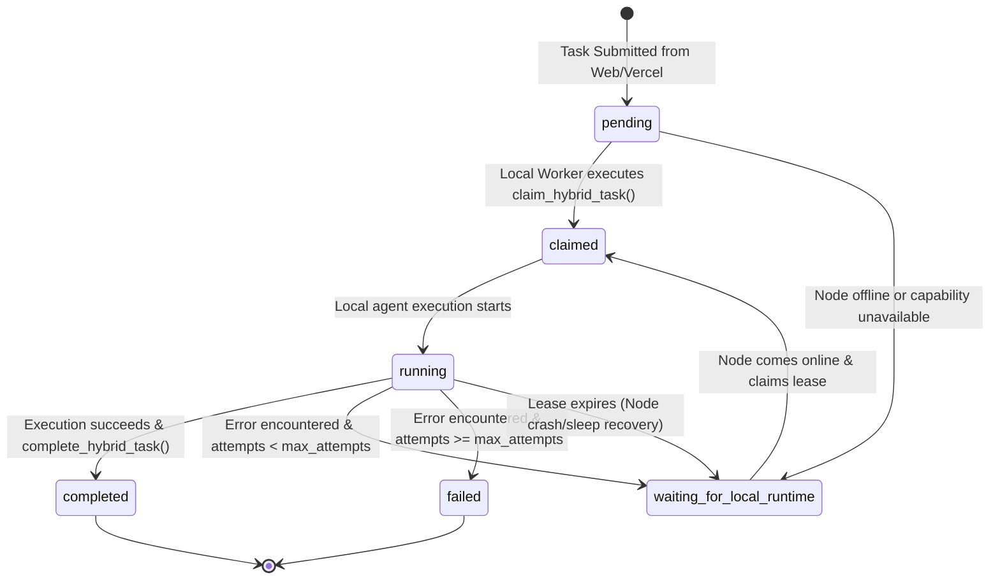

# Personal AI Workforce OS — Hybrid Runtime Architecture & Worker Specification

**Document Version:** 1.0.0  
**Implementation Modules:**  
- `core/adapters/supabase_adapter.py`
- `core/hybrid/runtime_worker.py`  
**Classification:** Core System Architecture  

---

## 1. Objective & Sovereign Design Principles

The Personal AI Workforce OS is architected to give the owner access from anywhere while maintaining absolute privacy and local sovereignty:

1. **Local-First Sovereign Execution:**
   - Real website logins, credentials, session tokens, browser automation (Playwright/Puppeteer), and local shell execution remain strictly on the physical MacBook Pro.
   - The cloud database (Supabase) stores only operational status, task queues, and non-sensitive outputs.
2. **Outbound-Only Connectivity (Zero Open Ports):**
   - The MacBook makes outbound HTTPS connections to Supabase and Vercel.
   - No public ports (such as SSH, HTTP, or remote desktop) are exposed on the local network or router.
   - Operates securely behind any residential NAT, corporate firewall, or mobile hotspot.
3. **Decoupled Asynchronous Lifecycle:**
   - Web actions submitted via Vercel are queued in Supabase.
   - If the MacBook is closed or offline, tasks are queued in `waiting_for_local_runtime` without timeout or data loss.
   - When the MacBook wakes or reconnects, the worker automatically claims and processes pending tasks.

---

## 2. Component Interaction & Sequence Flow

```
   Owner / Vercel API               Supabase Cloud (PostgreSQL)            MacBook Pro (Hybrid Worker)
          │                                      │                                      │
          │ 1. POST /api/tasks                   │                                      │
          │    (Title, Agent, IdempotencyKey)    │                                      │
          ├─────────────────────────────────────►│                                      │
          │                                      │                                      │
          │                                      │ 2. claim_hybrid_task(node_id)        │
          │                                      │    (Atomic: FOR UPDATE SKIP LOCKED)   │
          │                                      │◄─────────────────────────────────────┤
          │                                      │                                      │
          │                                      │ 3. Returns Task Data (Lease 300s)    │
          │                                      ├─────────────────────────────────────►│
          │                                      │                                      │
          │                                      │                                      │ 4. Load AGENT.md,
          │                                      │                                      │    SKILL.md, MEMORY.md
          │                                      │                                      │    Execute with tools
          │                                      │                                      │    (Browser/Shell/Vault)
          │                                      │                                      │
          │                                      │ 5. complete_hybrid_task(task_id, res)│
          │                                      │◄─────────────────────────────────────┤
          │                                      │                                      │
          │ 6. Query Task Status                 │                                      │
          ├─────────────────────────────────────►│                                      │
          │    Status: COMPLETED                 │                                      │
          │◄─────────────────────────────────────┤                                      │
```

---

## 3. Task State Transition Machine



### State Definitions
- **`pending`**: Newly submitted task in Supabase waiting to be claimed.
- **`waiting_for_local_runtime`**: Task requiring local MacBook execution while the workstation is offline or temporarily busy.
- **`claimed`**: Leased exclusively to a specific `node_id` with an expiration window (`lease_expires_at`).
- **`running`**: Actively executing in the local Python environment on the MacBook.
- **`completed`**: Successfully executed; output artifacts saved to Supabase.
- **`failed`**: Execution failed and exhausted retry limits (`max_attempts`).

---

## 4. Idempotency & Concurrency Guarantees

1. **Unique Idempotency Keys:**
   - Every `hybrid_tasks` record requires a client-generated `idempotency_key`.
   - If a duplicate submission occurs, the database rejects the duplicate with a 409 conflict, returning the existing task record without re-executing.
2. **Atomic Row Locking (`FOR UPDATE SKIP LOCKED`):**
   - The PostgreSQL stored procedure `claim_hybrid_task()` uses `FOR UPDATE SKIP LOCKED`.
   - Even if multiple workers or threads poll simultaneously, a task is leased to exactly one worker.
3. **Lease Expiration & Heartbeating:**
   - Each claim grants a 300-second lease.
   - Long-running tasks send heartbeats to extend the lease.
   - If the MacBook crashes or loses power, `reclaim_stale_tasks()` detects the expired lease and resets the task status to `waiting_for_local_runtime` for automatic recovery.

---

## 5. Offline Resiliency & Exponential Backoff

When the MacBook loses internet connection:
1. `SupabaseAdapter` catches network exceptions (`httpx.RequestError`, `httpx.TimeoutException`).
2. The worker logs an informational offline message:
   `Supabase is unreachable (offline mode active). Will poll locally.`
3. The worker transitions to exponential backoff (`5s -> 7.5s -> 11.2s -> ... -> 60s max`).
4. When connectivity returns, the backoff automatically resets to the default poll interval (5s) and normal queue processing resumes.

---

## 6. Worker CLI Usage & Service Management

### Running Standalone
```bash
cd /Users/ibrahimzid/AI-Workforce

# Single test polling cycle
PYTHONPATH=. .venv/bin/python core/hybrid/runtime_worker.py --once

# Continuous worker loop
PYTHONPATH=. .venv/bin/python core/hybrid/runtime_worker.py --interval 5.0
```

### Background Daemon via Launchd (macOS)
The worker can be managed as a macOS LaunchAgent (`~/Library/LaunchAgents/com.aiworkforce.worker.plist`) so it automatically starts on boot and restarts if interrupted:

```xml
<?xml version="1.0" encoding="UTF-8"?>
<!DOCTYPE plist PUBLIC "-//Apple//DTD PLIST 1.0//EN" "http://www.apple.com/DTDs/PropertyList-1.0.dtd">
<plist version="1.0">
<dict>
    <key>Label</key>
    <string>com.aiworkforce.worker</string>
    <key>ProgramArguments</key>
    <array>
        <string>/Users/ibrahimzid/AI-Workforce/.venv/bin/python</string>
        <string>/Users/ibrahimzid/AI-Workforce/core/hybrid/runtime_worker.py</string>
    </array>
    <key>WorkingDirectory</key>
    <string>/Users/ibrahimzid/AI-Workforce</string>
    <key>KeepAlive</key>
    <true/>
    <key>RunAtLoad</key>
    <true/>
    <key>StandardOutPath</key>
    <string>/Users/ibrahimzid/AI-Workforce/logs/hybrid_worker.log</string>
    <key>StandardErrorPath</key>
    <string>/Users/ibrahimzid/AI-Workforce/logs/hybrid_worker_err.log</string>
</dict>
</plist>
```
